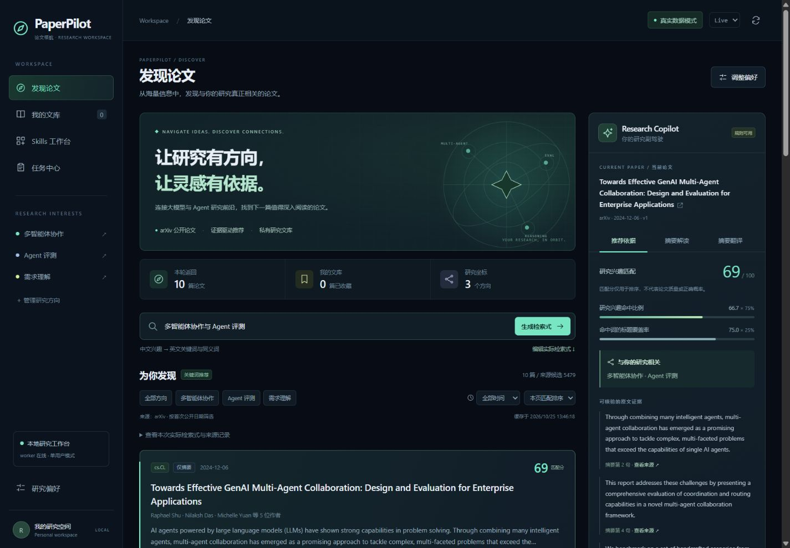
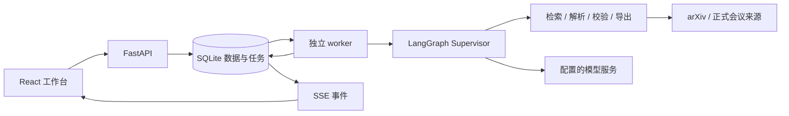

<div align="center">

# PaperPilot · 论文领航

**让研究有方向，让判断有证据。**

面向大语言模型与 Agent 研究的本地论文工作台。从研究兴趣、真实检索，到可解释推荐、全文精读、翻译与站内周报。

[](LICENSE)
[](backend/pyproject.toml)
[](frontend/package.json)

[快速开始](#快速开始) · [功能](#功能) · [模型配置](#模型配置) · [文档](#文档) · [参与贡献](#参与贡献)

</div>



*早期版本的实际界面截图；当前版本还包含本地论文、论文对比、术语表、主题订阅、站内周报与推荐反馈。*

<details>
<summary>目录</summary>

- [为什么是 PaperPilot](#为什么是-paperpilot)
- [功能](#功能) / [技术栈](#技术栈)
- [快速开始](#快速开始) / [模型配置](#模型配置)
- [翻译与 PDF](#翻译与-pdf)
- [系统结构](#系统结构) / [订阅、反馈与恢复](#订阅反馈与恢复)
- [开发与验证](#开发与验证) / [已知边界](#已知边界)
- [常见问题](#常见问题) / [文档](#文档)
- [参与贡献](#参与贡献) / [许可证](#许可证)

</details>

## 为什么是 PaperPilot

研究者需要的不只是论文列表，还需要知道“为什么推荐这篇”“依据来自哪里”“有哪些结论尚未核实”。PaperPilot 将检索、排序和原文证据放在同一工作台中，并把耗时的模型任务交给独立 worker 执行。

重点研究方向包括多智能体协作、Agent 评测、Agent 强化学习、大模型后训练，以及需求理解、约束抽取和方案校验。默认按**首次公开日期筛选近 730 天**；相关研究方向优先呈现有来源依据的 CCF A 会议论文，没有符合条件的已核实会议论文时回退到 arXiv。

> 当前版本面向本地单用户使用。没有模型密钥也能真实检索、筛选和收藏；模型分析、语义匹配和翻译会明确显示未配置或降级状态。演示数据与真实数据分开。

## 功能

| 模块 | 已实现能力 |
| --- | --- |
| 发现论文 | arXiv 查询、分页、日期过滤、版本去重、缓存、限流与错误提示；中文兴趣生成可编辑英文检索式 |
| CCF A 优先 | 结合 arXiv 与 NeurIPS / ICML / ACL 正式来源核验，保留录用证据；无符合条件结果时使用 arXiv |
| 可解释推荐 | 关键词分与可选大模型语义分对照，展示兴趣、摘要证据、评分依据和未知项 |
| 我的文库 | 持久收藏、已读、不感兴趣、个人标签与笔记；支持论文对比 |
| 本地论文 | 上传文本 PDF、内容去重、加入文库、摘要分析与翻译；本地论文不展示推荐评分 |
| 全文研究 | 优先解析结构化源文件，失败时回退 PDF 文本；结构化精读和总体分析附原文证据 |
| 翻译与术语 | 摘要 / 全文翻译、共享术语表、逐段对齐、检查点保存、失败块重试 |
| PDF 与导出 | 中文版与双语版 PDF、Markdown、BibTeX；支持源文件时保留原图、公式、表格与算法 |
| 主题订阅 | 用户主动启用，按北京时间定时入队；默认近两年、CCF A 优先、arXiv 回退 |
| 站内周报 | 周次与配置修订去重；规则周报无需模型，可主动启用模型增强评估 |
| 推荐反馈 | 相关性反馈影响后续排序，不相关项隐藏；支持撤回，保留原始评分 |
| 任务与 Skills | 实际后端 runner、输入输出约束、持久任务状态、SSE、取消、恢复和重复提交保护 |

匹配分是排序信号，**不是论文质量概率**。会议录用、实验结果、代码和数据的可用性必须有依据；缺失信息标记为未知。

## 技术栈

| 层 | 实现 |
| --- | --- |
| 前端 | React、TypeScript、Vite、Tailwind CSS |
| API | Python 3.12、FastAPI、Pydantic |
| 编排 | LangGraph Supervisor、受控 Skill runner |
| 持久化 | SQLite、LangGraph SQLite checkpoints |
| 长任务 | 独立 Python worker、持久队列、租约与心跳、单并发执行 |
| PDF | pypdf、ReportLab；图文排版可选项目内 Tectonic |
| 依赖复现 | `backend/uv.lock`、`frontend/package-lock.json` |

## 快速开始

### 1. 环境要求

- **Windows + PowerShell**：当前提供启动脚本与图文 PDF 排版支持。
- **Python 3.12**、**uv**。
- **Node.js 20.19+（20.x）或 22.12+**，附带 npm；具体范围见 `frontend/package.json`。
- 可访问论文来源网站；模型功能另需可用的 OpenAI 兼容 API。

核心 API / 前端采用跨平台技术，但项目内 Tectonic 路径和宋体默认配置面向 Windows，尚未提供完整 Linux / macOS 排版安装流程。

### 2. 获取代码并安装依赖

```powershell
git clone https://github.com/Zhou1694638133/PaperPilot.git
Set-Location PaperPilot

# 仅首次创建；保留已有配置
if (-not (Test-Path -LiteralPath '.env')) {
    Copy-Item -LiteralPath '.env.example' -Destination '.env'
}

Set-Location backend
uv sync --locked --python 3.12
Set-Location ../frontend
npm.cmd ci
Set-Location ..
```

后端锁文件使用项目配置中的 Python 包索引；前端使用 npm 锁文件。首次安装需要网络，不包含已安装的虚拟环境或 node_modules。

### 3. 启动三个进程

在**项目根目录**打开三个 PowerShell 终端，分别执行：

```powershell
# 终端 1：API
.\scripts\start.ps1 api
```

```powershell
# 终端 2：worker；执行模型任务与订阅调度
.\scripts\start.ps1 worker
```

```powershell
# 终端 3：Web
.\scripts\start.ps1 web
```

- 工作台：<http://127.0.0.1:5173>
- API 文档：<http://127.0.0.1:8000/docs>
- 健康检查：<http://127.0.0.1:8000/api/health>

首次启动会初始化数据库。每个终端按 `Ctrl+C` 停止对应服务。关闭 API 不等于关闭 worker；订阅调度需要 worker 持续运行。

如果 PowerShell 执行策略阻止 `.ps1`，可以使用等价命令，无需修改系统策略：

```powershell
# 终端 1，backend 目录
.\.venv\Scripts\python.exe -m uvicorn app.main:app --host 127.0.0.1 --port 8000

# 终端 2，backend 目录
.\.venv\Scripts\python.exe -m app.worker

# 终端 3，frontend 目录
npm.cmd run dev
```

### 4. 开始研究

1. 在“研究偏好”保存研究兴趣，保留默认近两年或调整日期范围。
2. 在“发现论文”生成、核对英文检索式，运行真实检索。
3. 查看推荐证据，收藏论文；按需运行模型语义匹配，与关键词评分对照。
4. 打开论文详情，读取全文、核对解析警告，再执行精读、总体分析或翻译。
5. 在“中文翻译”和“双语对照”分别下载产物；在任务中心查看真实进度或继续未完成部分。
6. 在“主题订阅”主动开启计划，或手动生成本期周报；用推荐反馈调整后续结果。

本地文件从侧栏“本地论文”上传，当前支持 **20 MiB / 150 页以内的文本 PDF**。扫描件暂无 OCR。需要模型处理时，解析文本会发送到你配置的模型服务。

## 模型配置

推荐通过 **研究偏好 → 大模型配置** 填写 API 地址、模型名称和 API Key，先测试连接，再保存。

- 使用 OpenAI 兼容的 Chat Completions 接口；API 地址填写服务基地址。
- 测试连接会发起一次真实的短生成请求，可能产生费用；测试成功不等于已保存。
- 保存后 API 与 worker 自动读取配置。密钥不返回给前端，也不保存在浏览器存储中。
- 密钥留空表示保留现有值；修改服务地址时需重新输入对应密钥或清除密钥。
- 页面配置保存在后端 `data/model-config.json`，是**本机明文凭据文件**，并非加密密钥保险库。

也可以在根目录 `.env` 设置初始配置：

```dotenv
LLM_BASE_URL=https://api.openai.com/v1
LLM_MODEL=your-model-name
LLM_API_KEY=your-api-key
```

页面保存的模型配置优先于 `.env`。仅手工修改 `.env` 时，需要重启 API 和 worker。不同服务对 JSON mode、token 参数、temperature 的支持不同，请参考 [.env.example](.env.example) 与[模型配置说明](docs/model-config.md)。

| 配置 | 用途 |
| --- | --- |
| `APP_MODE` | 默认模式，`live` / `demo` |
| `DATABASE_PATH` | 可选绝对 SQLite 路径；默认 `data/paperpilot.db` |
| `LLM_BASE_URL` / `LLM_MODEL` / `LLM_API_KEY` | 模型地址、名称与凭据 |
| `LLM_TIMEOUT` / `LLM_MAX_TOKENS` | 单次模型调用超时与输出上限 |
| `LLM_TRUST_ENV` | 是否继承系统代理和证书环境 |
| `ARXIV_TIMEOUT` / `ARXIV_CACHE_TTL` | 检索超时与缓存有效期 |
| `ARXIV_MIN_INTERVAL` | arXiv 请求最小间隔，后端强制不少于 3 秒 |
| `FULLTEXT_TIMEOUT` | 全文获取超时 |
| `PDF_FONT_PATH` | ReportLab 导出的中文字体路径；默认 Windows 宋体 |

**没有模型密钥时**，元数据检索、规则推荐、收藏、全文解析、反馈和规则周报仍可用；新语义分析、精读和翻译不可用。已有产物可以下载。中文图文 PDF 如果还缺少标题、图注等补译，则需要模型完成这些部分。

## 翻译与 PDF

中文版采用黑色宋体；中文版与双语版使用固定单栏 / 双栏模板，依据原文布局选择。译文按实际长度自然分页，不承诺逐页等长。文件名使用原论文标题加“翻译版”。

图文 PDF 需要安装项目内 Tectonic。在根目录执行一次：

```powershell
.\scripts\install-tectonic.ps1
```

脚本下载固定版本并校验 SHA-256，不修改全局 PATH。首次编译可能下载 TeX 宏包；需要 Windows 宋体，使用相关图标的论文还会加载对应字体包。仓库不分发编译器二进制或字体文件。

- **有可支持的结构化源文件**：保留原始图件，排版公式、表格和算法；中文正文与补译分别存检查点。
- **只有 PDF 文本**：可翻译已解析内容，不能保证恢复图像、阅读顺序和数学版式；页面会显示限制。
- **本地 PDF**：识别到 arXiv 编号后，可核对版本并恢复源文件；不能可靠匹配时保留文本路径，不猜补内容。
- **续译与重排**：复用成功检查点，仅处理未完成块或缺少的补译。双语下载复用既有译文，不重新调用模型。
- **保留原文的内容**：作者姓名、必要英文缩写、参考文献、原图内部文字和原始代码。特殊宏或缺图会明确报错。

详细说明：[中文与双语 PDF](docs/chinese-pdf.md) · [本地上传](docs/local-upload.md) · [翻译恢复](docs/translation-reliability.md)。

## 系统结构



普通代码处理检索、去重、缓存、校验与导出；模型处理语义分析、精读、翻译及研究建议。Skill 规范位于 `skills/`，实际执行由后端注册表与 runner 负责，不能仅添加一个 `SKILL.md` 就获得执行权限。

```text
PaperPilot/
├── backend/
│   ├── app/             # API、数据访问、检索、排序、worker 与 Skill runner
│   ├── tests/           # 后端回归测试
│   ├── pyproject.toml
│   └── uv.lock
├── frontend/
│   ├── src/             # 页面、组件、类型与样式
│   └── package-lock.json
├── skills/              # Skill 规范、schema 与固定排版模板
├── scripts/             # 启动、依赖安装与验收脚本
├── docs/                # 架构、功能边界、操作与验证记录
├── .env.example
└── LICENSE
```

`data/` 在运行时生成，包含文库、反馈、订阅、模型配置、源文件缓存、任务和翻译检查点。`output/`、`tmp/` 是本地验证或导出目录。这些内容不随代码发布；备份应覆盖整个数据目录，不能只备份单个业务表。自定义数据路径时也应保护其配置和数据库文件。

## 订阅、反馈与恢复

- 订阅默认暂停，只有用户主动启用才定时运行。时区为 **UTC+8 / 北京时间**。
- worker 每 30 秒检查计划，长任务执行期间也能入队；执行仍为单并发。关机期间不运行，重启补本周一次。
- 同一订阅内容修订与周次复用已有任务。改名或改执行时间不会重复生成本期内容；修改检索内容会创建新的配置修订。
- 周报保留生成时的论文、来源与分数快照；反馈影响后续检索和新周报，不悄悄改写历史报告。
- 反馈采用显式分数调整和隐藏规则，**不是模型在线训练**；模型增强周报需另行主动开启。
- 任务通过 SSE 推送真实阶段。普通中断可恢复；模型请求结果不确定时会要求核对调用记录，避免静默重复计费。
- 取消不能撤回已发送的远端请求。成功结果先保存为检查点，再停止后续步骤。

## 开发与验证

使用锁文件安装后，在项目根目录运行：

```powershell
# 后端测试使用独立临时目录，不清空用户文库
Set-Location backend
.\.venv\Scripts\python.exe -m pytest -q --basetemp ../tmp/pytest

# TypeScript 检查与生产构建
Set-Location ../frontend
npm.cmd run typecheck
npm.cmd run build
Set-Location ..
```

也可运行 `.\scripts\verify.ps1`，它会按锁文件同步依赖、运行测试并构建前端。仓库没有承诺所有真实外部服务始终在线；mock 测试不能替代模型质量或实际来源验收。

`scripts/verify_*.py` 中的部分脚本用于特定论文或历史任务，需要相应本地缓存 / 任务 ID；并非新克隆后的通用初始化步骤。涉及真实模型的脚本应先阅读参数和费用说明。历史验收记录在 `docs/verification*.md`，其中本地文件路径仅供原环境追溯，不代表仓库附带这些论文或数据。

## 已知边界

- CCF A 核验只覆盖当前适配来源与证据目录，**不是完整 CCF A 论文索引**。Google Scholar 仅提供外部检索链接，不自动抓取。
- 已实现模型语义评分 / 重排；embedding 向量召回、通用 OpenReview 与 Semantic Scholar 检索适配器尚未启用。
- 日期过滤依据首次公开日期，更新日期不作为新论文发表日期。
- 推荐主要使用标题和摘要；全文研究只覆盖成功解析的内容，缺页、乱码、缺少实验信息不会猜补。
- 当前使用 SQLite，没有开箱即用的 PostgreSQL 迁移或多用户方案。
- 没有账户系统、完整公网认证与数据隔离；默认仅绑定回环地址，不应直接暴露到公网。
- 没有 Docker / 云部署配置。面向公开服务的部署需要先补充认证、权限、任务配额与数据隔离，再配置反向代理、持久存储和备份。

## 常见问题

**worker 显示未连接 / 任务一直排队？**

确认 API 和 worker 来自同一项目、读取同一 `DATABASE_PATH`，且都已经重启加载最新配置。启动 API 不会替代启动 worker。

**PyCharm 报相对导入错误？**

工作目录设为 `backend`，解释器使用 `backend/.venv`。API 运行模块 `uvicorn`，参数为 `app.main:app --host 127.0.0.1 --port 8000`；worker 运行模块 `app.worker`，不填写 API 参数。不要把 Python 可执行文件填入 `.env` 路径。

**模型连接测试成功，旧任务仍显示失败？**

失败状态属于上次执行记录。修复网络后在任务中心显式继续，成功检查点仍复用。遇到“结果待确认”时先核对提供方调用记录。

**检索不到论文？**

检查英文查询、排除词和近两年限制；阅读经典论文时调整日期范围。接口失败会显示错误或缓存状态，不会偷偷替换成演示结果。

**PDF 缺图或编译失败？**

先核对是否取得同版本结构化源文件，再检查 Tectonic、字体和宏包网络。仅 PDF 文本回退不能等同于保留原图的排版。

**5173 或 8000 被占用？**

检查已有进程。Vite 使用 `strictPort`，不会静默换端口；若主动更改端口，还需同步代理与后端允许来源。

## 文档

- [架构与数据流](docs/architecture.md) / [API](docs/api.md)
- [会议优先检索](docs/conference-discovery.md) / [语义匹配](docs/semantic-matching.md)
- [模型配置](docs/model-config.md) / [本地论文](docs/local-upload.md)
- [全文研究与对比](docs/stage2.md) / [中文与双语 PDF](docs/chinese-pdf.md)
- [翻译预检与恢复](docs/translation-reliability.md)
- [主题订阅、周报与反馈](docs/stage3.md)
- [模型增强周报与总体分析](docs/analysis-and-weekly-model.md)

## 参与贡献

欢迎通过 [Issues](https://github.com/Zhou1694638133/PaperPilot/issues) 报告问题，或提交 Pull Request。

1. 描述可复现步骤、预期行为与实际行为，日志先移除密钥和个人数据。
2. 修复尽量保持范围集中，并补充相关回归测试。
3. 按锁文件安装依赖，执行后端测试及前端构建。
4. 不提交 `.env`、模型配置、数据库、个人论文、翻译产物或虚拟环境。

目前没有必须安装的新贡献工具或额外提交钩子。

## 许可证

项目沿用 [Apache License 2.0](LICENSE)。论文、原图、第三方依赖及字体的权利归各自权利人；项目许可证不重新授予这些内容的使用或分发权。
